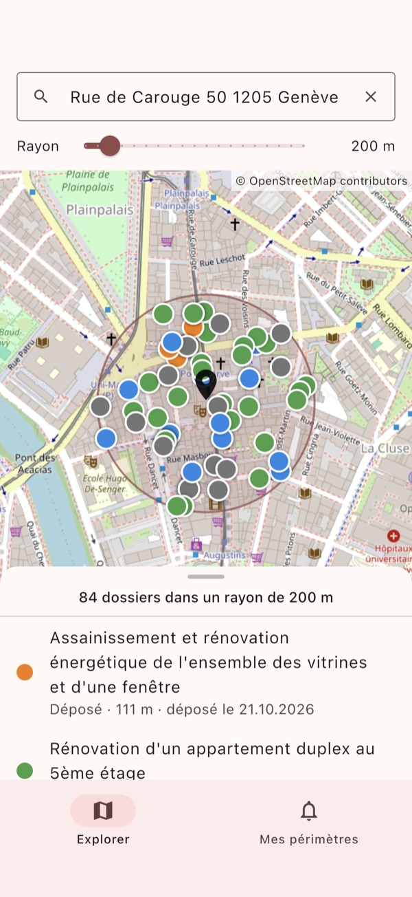
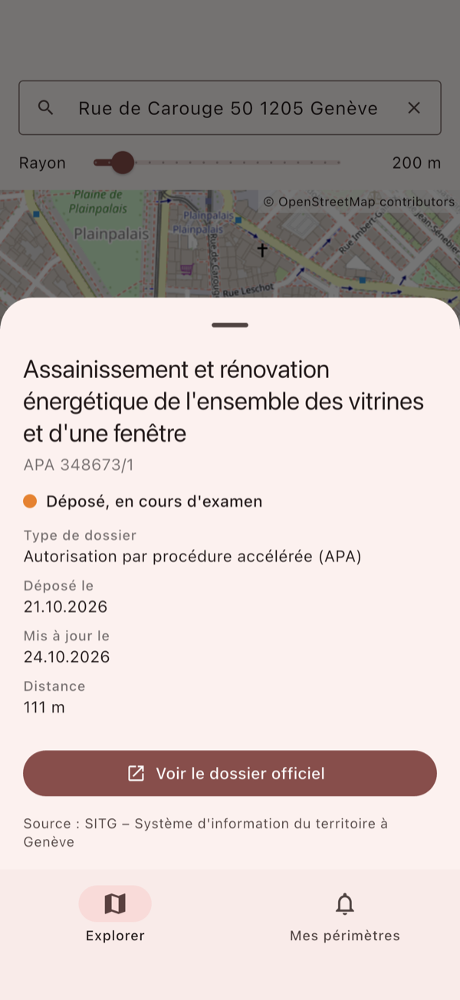
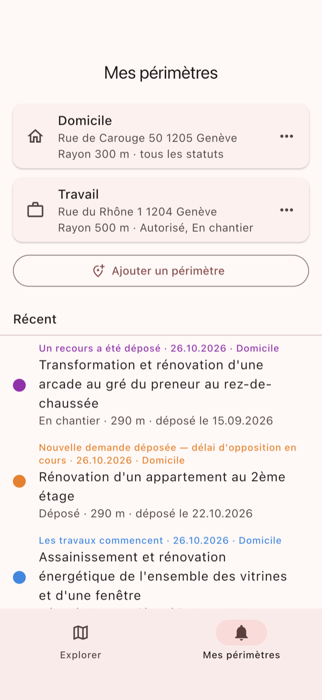
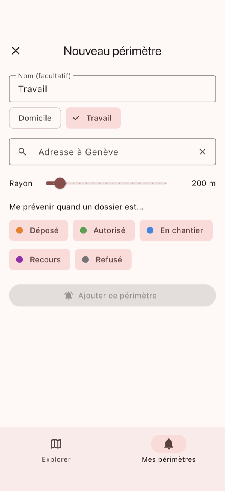

# Périmètre

**Know what is being built around you, in Geneva.**

Périmètre is a small civic app for the canton of Geneva (Switzerland). Pick one or more addresses, a radius
(100–1000 m) and the steps you care about. You get a push notification when a building-permit application
is filed in that perimeter, or when one changes status: authorised, construction starting, appealed,
refused. An *Explorer* tab shows every open dossier around any address on a map.

No account and no ads. The data is the canton's official open data, refreshed every night.

| Explorer | Dossier | My perimeters | New perimeter |
|---|---|---|---|
|  |  |  |  |

*(Screenshots from a development build against a local database; the "Récent" events are fabricated by
the dev endpoint. The app is in French.)*

## How it works

```
 SITG open data (ArcGIS FeatureServer, SIT_AUTOR_DOSSIER)
        │  nightly 03:15 incremental import, Sunday 03:45 full refresh
        ▼
 ┌───────────────────────────── backend (Spring Boot 4, Java 21) ─────────────────────────────┐
 │ import ─► upsert dossiers ─► detect events (new dossier, status group change)               │
 │                                   │                                                         │
 │                                   ▼                                                         │
 │ match events to subscriptions (PostGIS ST_DWithin, radius + categories) ─► one push per     │
 │ event and device (≤ 3 per night, else a summary) ─► Firebase Cloud Messaging ─► APNs        │
 │                                                                                             │
 │ REST API: /dossiers (map search), /devices (installations, their perimeters, event feed)    │
 └──────────────────────────────────────────┬──────────────────────────────────────────────────┘
                                            │ PostgreSQL 17 + PostGIS
 app (Flutter, iOS first) ──── HTTPS ───────┘   address search: geo.admin.ch (Swiss federal geoportal)
```

- `backend/`: Spring Boot 4 (modular starters), Java 21, Gradle. Hand-written SQL through `JdbcClient`, no
  ORM; Flyway migrations; PostGIS geography indexes for radius queries.
- `app/`: Flutter (Riverpod, go_router, flutter_map, dio, firebase_messaging). Two tabs: *Explorer* and
  *Mes périmètres*. iOS is the primary target; Android compiles but has no push configuration yet.
- `deploy/`: the production setup, which is Docker Compose with Caddy, the backend and PostGIS on a single small VPS,
  plus bootstrap, deploy and backup scripts.
- `docs/`: map-tile provider evaluation, App Store checklist, screenshots.
- [`CLAUDE.md`](CLAUDE.md): the detailed design notes (import rules, status mapping, data model, API,
  notification rules, conventions). It is the reference for anyone working on the code, human or AI.

## Data source

Building-permit dossiers come from the **SITG, Système d'information du territoire à Genève**, layer
`SIT_AUTOR_DOSSIER` ("Autorisations de construire"), through its public ArcGIS REST service.

- **Attribution:** "Source : SITG – Système d'information du territoire à Genève". The app credits it in
  the dossier details, on the website, and here.
- **Terms:** SITG open geodata is governed by the *Conditions générales d'utilisation des géodonnées du SITG
  en libre accès* (2020). Article 6 allows extracting and using it for private, educational or commercial
  purposes, and citing the source is mandatory ([text on LexFind](https://www.lexfind.ch/tolv/246868/fr)).
  On [opendata.swiss](https://opendata.swiss) SITG datasets are labelled "Open use. Must provide the
  source. Use for commercial purposes requires permission of the data owner." Périmètre is free and
  non-commercial. If you build something commercial on it, check with the SITG first.
- Périmètre is an independent project. It is not published or endorsed by the État de Genève or the SITG.
  The data is shown as published, and SITG's official dossier page (`lien_sad`) is the reference.

Address search uses the [geo.admin.ch](https://www.geo.admin.ch) search API (free, no key). The
development map uses OpenStreetMap's public tiles, which are **not allowed for a published app**; see
[`docs/map-tiles.md`](docs/map-tiles.md) for the production options.

## Local development

Prerequisites: Docker, a JDK (the Gradle toolchain provisions Temurin 21 itself), Flutter 3.47 and Xcode
for iOS.

```bash
# Database (PostGIS on localhost:5433) and Redis (localhost:6380, not used by the backend yet)
docker compose up -d

# Backend on localhost:8090; the dev profile adds POST /admin/dev/emit to fabricate events
cd backend
./gradlew bootRun --args='--spring.profiles.active=dev'

# First import (~21k dossiers, a few seconds). Without ADMIN_TOKEN, /admin is open locally (with a WARN).
curl -X POST 'http://localhost:8090/admin/import?mode=full'
curl 'http://localhost:8090/dossiers?lat=46.1930&lng=6.1412&radius=300'
```

```bash
# App, without Firebase (pushes are simulated: fake token, nothing delivered)
cd app
cp lib/firebase_options.dart.example lib/firebase_options.dart
cp ios/Runner/GoogleService-Info.plist.example ios/Runner/GoogleService-Info.plist
flutter pub get
flutter run -d <simulator id> --dart-define=API_BASE_URL=http://localhost:8090
```

Debug builds default to `http://localhost:8090`. Release builds default to the production API, and
`--dart-define=API_BASE_URL=…` always wins. To fabricate an event and watch the push pipeline (logged by
`LogPushSender` when Firebase is not configured):
`curl -X POST -G localhost:8090/admin/dev/emit --data-urlencode 'id_dossier=<id>' -d new_groupe=CHANTIER`.

### Push notifications

Real pushes go through Firebase Cloud Messaging (APNs on iOS). You need your own Firebase project:

1. Create a Firebase project with an iOS app (your bundle id) and upload an APNs key (.p8) in its Cloud
   Messaging settings.
2. In `app/`: `flutterfire configure --project=<id> --platforms=ios`. This writes `lib/firebase_options.dart`,
   `ios/Runner/GoogleService-Info.plist` and `firebase.json`, which are git-ignored on purpose.
3. Download a service-account key to `backend/.secrets/firebase-service-account.json` (git-ignored) and
   start the backend with `FIREBASE_CREDENTIALS=.secrets/firebase-service-account.json`.

Never commit any of these: service-account JSON, `.p8`/`.p12` keys, `.env*` files and the Firebase client
config are all in `.gitignore`, and CI runs gitleaks on every merge request.

### Tests

```bash
cd backend && ./gradlew test        # unit + context tests (need the local PostGIS running)
cd app && flutter analyze
cd app && flutter test integration_test/subscription_flow_test.dart -d <simulator id>   # E2E, local backend
```

`PERIMETRE_PERF=1 ./gradlew test --tests '*DispatchPerformanceTest' -i` seeds 10,000 subscriptions and
prints the matching query plan and timings.

## Self-hosting

The reference deployment runs on one VPS (2 vCPU, 4 GB RAM, Ubuntu 24.04) for the whole canton.

1. **DNS:** A records for your domain, `api.<domain>` and `www.<domain>` pointing to the server. Replace
   `perimetre.ch` in `deploy/Caddyfile` and `deploy/site/`.
2. **Server:** `ssh <host> 'sudo bash -s' < deploy/bootstrap.sh`. This sets up the firewall (22/80/443),
   SSH hardening, fail2ban, unattended upgrades, Docker, the app directory `/opt/perimetre` and the
   nightly backup cron.
3. **Configuration** (on the server only): `/opt/perimetre/.env.prod` from `deploy/.env.prod.example`
   (mode 600: database password, `ADMIN_TOKEN` of at least 32 characters, optional healthchecks.io URL)
   and `/opt/perimetre/secrets/firebase-service-account.json`.
4. **Image:** CI (`.gitlab-ci.yml`) builds `backend/Dockerfile` on every push to main. Point
   `deploy/docker-compose.prod.yml` at your registry, or build the image on the server.
5. **Deploy:** `deploy/ship.sh` (set `TARGET`, the SSH host alias, and `DIR` at its top). It syncs `deploy/`,
   pulls the image, restarts and waits for health. Then run the first import:
   `curl -X POST -H "Authorization: Bearer $ADMIN_TOKEN" https://api.<domain>/admin/import?mode=full`.
   That run records a baseline and sends no notifications.
6. **Operations:** imports run at 03:15 (incremental) and Sundays 03:45 (full), Europe/Zurich.
   `GET /admin/job-runs` lists the runs. The optional `HEALTHCHECK_PING_URL` alerts you when a nightly run
   is missing or fails. `deploy/backup.sh` keeps 14 days of `pg_dump`; copy them off the server.
7. **App:** build with `--dart-define=API_BASE_URL=https://api.<domain>`, your bundle id and your Firebase
   config. Choose a map tile provider (see `docs/map-tiles.md`). Publish your own privacy page: the
   template in `deploy/site/privacy.html` describes what is stored.

## Privacy

The app has no accounts. For each perimeter the server stores the address and its coordinates, the radius,
the categories and an optional name. Per installation it stores the push token and a random installation
id. It does not use analytics or tracking. The full policy (French) is in
[`deploy/site/privacy.html`](deploy/site/privacy.html) and at https://perimetre.ch/privacy.

## License

Copyright (C) 2026 Daniel Laera

This program is free software: you can redistribute it and/or modify it under the terms of the **GNU Affero
General Public License, version 3** ([`LICENSE`](LICENSE)). If you run a modified version as a network
service, the AGPL requires you to offer your users its source code.

The SITG data is not covered by this license; it remains under the SITG's terms (see "Data source").
